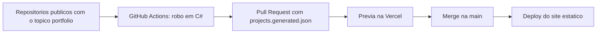

# Portfólio de Bernardo Fernando

Portfólio de um desenvolvedor back-end em que a interface é só a vitrine: a lista de projetos se atualiza sozinha a partir dos meus repositórios públicos do GitHub, por meio de um robô em C# que roda no GitHub Actions e abre um Pull Request para eu revisar.

Site: https://portfoliobernardofm.vercel.app/

## Por que este projeto existe

Sou desenvolvedor back-end e não queria um portfólio que mostrasse apenas um resultado visual. Queria um que mostrasse como eu penso: automação, testes, contratos de dados entre as partes e decisões justificadas. O site é o resultado, e o que está por baixo dele é o que eu quero que seja avaliado.

## Princípios

- **Conteúdo meu, automação no resto.** Os textos dos projetos vêm dos READMEs que eu escrevo. Nenhuma IA gera texto para o site.
- **Contrato claro entre as partes.** Dois arquivos JSON separam o que é automático do que é decisão minha.
- **Revisão humana antes de ir ao ar.** O robô propõe, eu aprovo.
- **Simples antes de sofisticado.** Site estático, sem servidor para manter.
- **Acessibilidade e dois idiomas (PT e EN) desde o início.**

## Arquitetura



O site não chama nenhuma API em tempo de execução. Tudo que ele mostra vem de arquivos JSON lidos no build.

## O robô de atualização

Fica em `tools/projects-sync`, escrito em C# (.NET 8).

- Consulta a API REST do GitHub e seleciona os repositórios públicos com o tópico `portfolio`, descartando forks e arquivados.
- Extrai título e resumo do README com um parser próprio, que ignora badges, imagens, HTML, blocos de código e linhas de navegação. Se não acha um resumo, usa a descrição do campo About do repositório.
- Gera o JSON sempre na mesma ordem e só grava quando algo mudou, para o diff do Pull Request mostrar apenas mudanças reais.
- Tem testes (xUnit) para o parser e para as regras de seleção. Eles rodam antes de cada execução, e se algum falhar nada é gerado.
- O workflow roda uma vez por dia e também manualmente, com permissões mínimas. Mantém um único Pull Request aberto e o fecha sozinho se a mudança deixar de existir.

## Front-end

- Angular com componentes standalone e Signals, CSS puro baseado em tokens e testes com Vitest.
- Carrossel com um projeto em destaque e os vizinhos reduzidos. Navega por setas, teclado, clique no vizinho e gesto de arrastar.
- Dois idiomas, com um serviço de tradução reativo que também atualiza o atributo `lang` do documento.
- A lista final junta `projects.generated.json` (feito pelo robô) com `projects.overrides.json` (feito por mim): primeiro some o que tem `hidden`, depois vêm quem tem `priority`, e o resto segue do push mais recente para o mais antigo.
- Elementos semânticos, contraste mínimo de 4,5:1, foco visível, alvos de toque de 44 px e respeito a `prefers-reduced-motion`.

## Decisões e trade-offs

- **Site estático em vez de servidor.** Planejei uma VM (Oracle e depois Google Cloud) com Nginx e deploy por SSH. Troquei pela Vercel porque o site é estático e não fazia sentido manter ou pagar infraestrutura agora. Volto a essa ideia quando houver mais aplicações rodando.
- **Tópico como opt-in.** Só entra no site o repositório que eu marco, para que testes e exercícios não apareçam sem eu querer.
- **Pull Request em vez de commit direto.** Eu vejo a prévia antes de qualquer mudança ir ao ar.
- **Robô sem IA.** O parser é determinístico: mais previsível, testável e barato do que chamar um modelo de linguagem.
- **Projetos privados por repositório vitrine público.** Não entrego ao robô uma credencial de leitura de código privado. Escrevo um README público que apresenta a ideia.

## Como rodar

Site:

```bash
npm install
npx ng serve
npx ng test --watch=false
npm run build   # saída estática em dist/portfolio/browser
```


## Limitações e próximos passos

- Os resumos vêm dos READMEs em português e aparecem assim também na versão em inglês, com um aviso discreto. Um resumo em inglês é uma evolução possível.
- O botão `Ler README` abre o README na página do repositório.
- O GitHub desativa workflows agendados depois de 60 dias sem atividade em repositório público, então o robô pode precisar ser reativado.
- A data do último push muda a cada commit, o que gera atualizações frequentes no Pull Request.

## Como foi construído

Construído com apoio de IA. O desenho, as decisões e a revisão são meus. Parte do código, no front-end e no robô, foi escrita com assistência de IA, em fatias pequenas e revisadas por Pull Request, seguindo um briefing que eu escrevi (`AGENTS.md`). Cada decisão descrita aqui eu consigo explicar.
